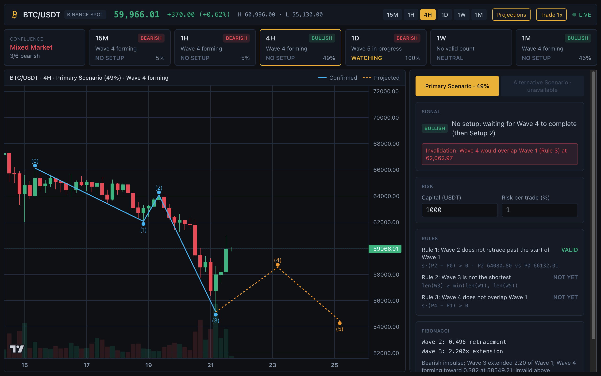
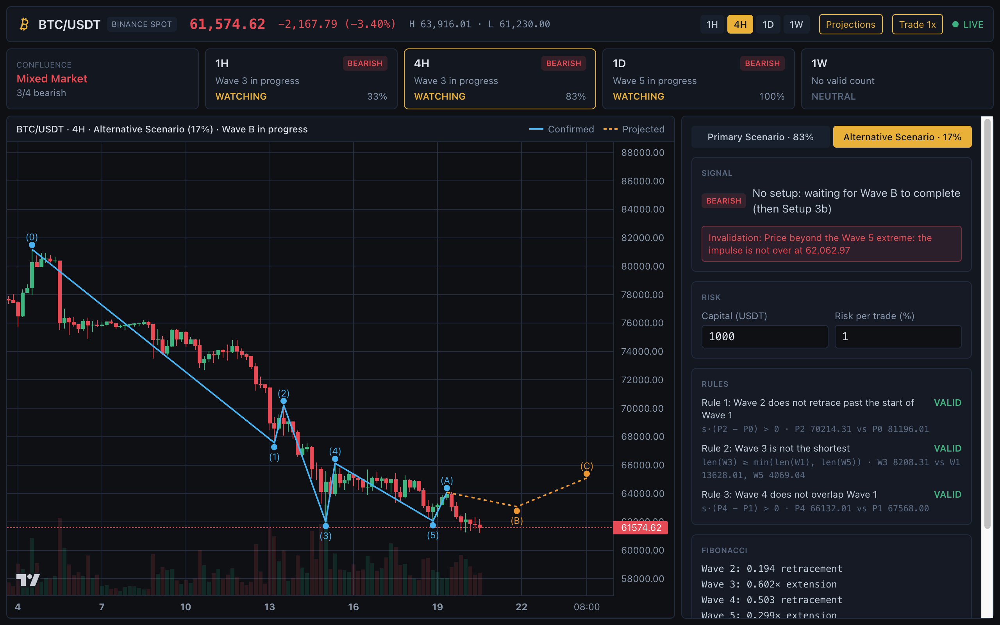
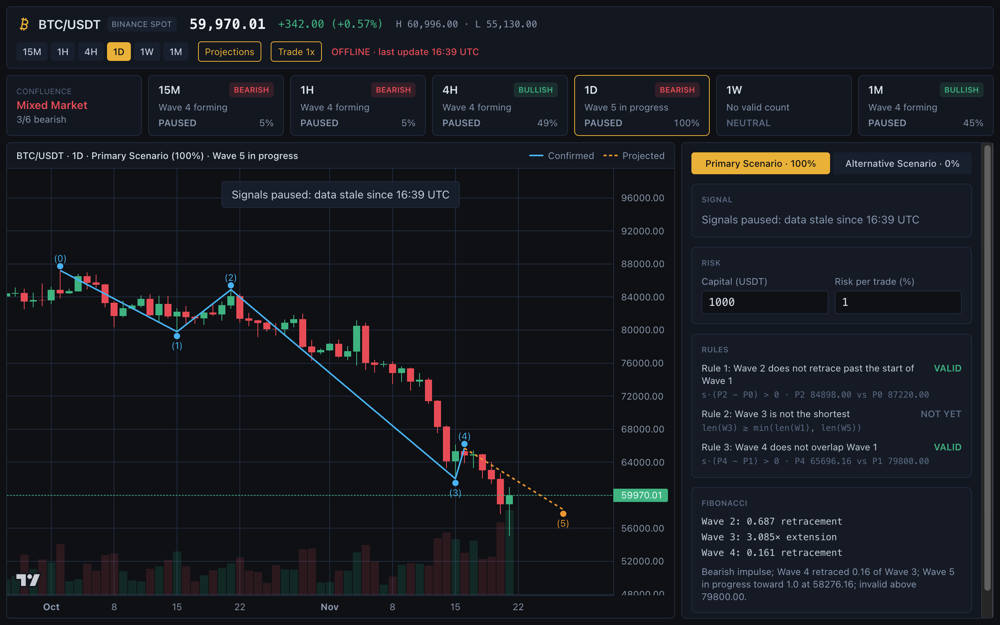
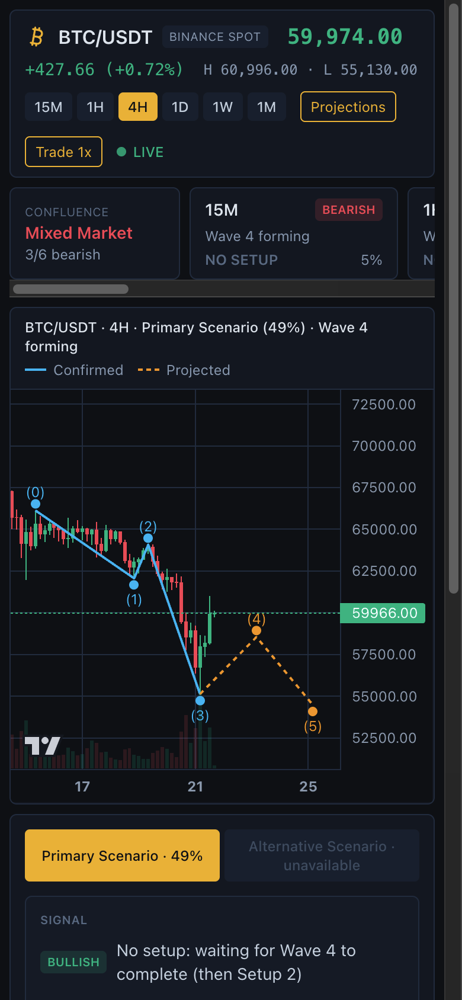

# btc-elliott-dashboard

A personal, read-only BTC/USDT dashboard that counts Elliott waves on four timeframes, ranks the
counts into a Primary and an Alternative Scenario, and turns them into 1x (unleveraged) trade
signals with position sizing and multi-timeframe confluence. Live data comes from Binance's public
REST and WebSocket APIs, with no API key. It never places orders.

Live at **<https://btc-elliott.allisson.dev>**.



> **Not financial advice.** The dashboard shows what an algorithm reads in the price. You decide
> and act manually.

## Features

- **Wave counts on 1h, 4h, 1d and 1w**: adaptive ZigZag pivots, every candidate count from the
  last 8 pivots, checked against the three Elliott rules and scored against Fibonacci ratios.
- **Primary and Alternative Scenarios**: the two best counts, each with a confidence, the wave in
  progress, projected waves with target ranges, an invalidation price and a one-line thesis.
- **1x signals**: four setups (Wave 2→3, Wave 4→5, Wave 5 exhaustion, Wave B→C), mirrored for
  LONG and SHORT, with entry, stop loss, TP1, TP2, R:R and an `ACTIVE` / `WATCHING` /
  `INVALIDATED` status updated on every tick.
- **Position sizing**: the whole capital, 1x. The risk per trade sets the stop loss that far from
  the entry, so hitting it loses exactly that share of the capital.
- **Confluence**: the four timeframes' Primary Scenarios vote on a direction.
- **Live, and honest when it is not**: candles and ticker stream over one WebSocket. When the
  stream drops, signals pause and the header says since when. When it comes back, history is
  refetched before signals resume. No synthetic data ever reaches the screen.
- **Copy Setup**: the current signal as plain text, ready to paste.

## Screenshots

| Alternative Scenario | Paused (stream down) |
| :-- | :-- |
|  |  |

<p align="center">
  
</p>

## Quick start

Requires [Bun](https://bun.sh).

```bash
bun install
bun dev              # http://localhost:5173
```

| Command | What it does |
| :-- | :-- |
| `bun dev` | Local dev server |
| `bun run test` | Vitest suite (not `bun test`, which is Bun's own runner) |
| `bun run build` | Type-check and production build into `dist/` |
| `bunx tsc --noEmit` | Type-check only |
| `bun scripts/record-snapshots.ts` | Re-record the real Binance fixtures used by the tests |

The build is a static site: `dist/` can be served from any static host. A tag `v<version>` on
`main` deploys it to Cloudflare Pages ([deployment](docs/deployment.md)).

## How it works

Everything below runs in the browser. The analysis of a timeframe is recomputed only when one of
its candles closes; ticker updates refresh only the price-dependent numbers (entry, Δ%, R:R,
status, position size).

### 1. Pivots

An adaptive ZigZag runs over each timeframe's closed candles. A peak is confirmed once price falls
`θ` below it, a trough once price rises `θ` above it. The last, still-moving extreme is never a
pivot.

| Timeframe | ZigZag threshold `θ` |
| :-- | --: |
| 1h | 1.8% |
| 4h | 3.2% |
| 1d | 5.5% |
| 1w | 9.5% |

### 2. Counts and rules

A count must end at the latest pivot. For each anchor among the last 8 pivots, the pivots from
the anchor to the end form one candidate, labelled `(0)(1)(2)` up to `(0)…(5)(A)(B)`. A trough
anchor gives a bullish count, a peak a bearish one. A candidate is discarded if it breaks a rule:

- **Rule 1**: Wave 2 does not retrace past the start of Wave 1.
- **Rule 2**: Wave 3 is not the shortest of Waves 1, 3 and 5.
- **Rule 3**: Wave 4 does not overlap Wave 1.

### 3. Scoring and scenarios

Each measured ratio gets a grade by its distance `d` to the nearest Fibonacci target:
`grade = max(0, 1 − d / 0.15)`. A count's score is the mean of its grades.

| Ratio | Targets |
| :-- | :-- |
| W2 retracement of W1 | 0.5, 0.618, 0.786 |
| W3 extension of W1 | 1.618, 2.618 |
| W4 retracement of W3 | 0.382, 0.5 |
| W5 extension of W1 | 1.0 |
| A retracement of the impulse | 0.382, 0.5 |
| B retracement of A | 0.5, 0.618 |

The best count is the **Primary Scenario** and the second the **Alternative Scenario**. Primary
confidence is `pP / (pP + pA) × 100`. A timeframe with no valid count is **Neutral**: no scenario,
no signal, no vote. Each scenario projects the waves still to come and carries an invalidation
price: P0 for a count at (2), P1 at (3) and (4), the Wave 5 extreme at (5), (A) and (B).

### 4. Setups and signals

The scenario's last point picks the setup. Shown for a bullish impulse; a bearish one mirrors
every direction.

| Setup | Last point | Trigger | Side | TP1 | TP2 |
| :-- | :-- | :-- | :-- | :-- | :-- |
| 1: Wave 2→3 | (2) | W2 retracement in [0.382, 0.886] | LONG | P1 | Wave 3 at 1.618 |
| 2: Wave 4→5 | (4) | W4 retracement in [0.236, 0.5] | LONG | P3 | projected Wave 5 |
| 3a: Wave 5 exhaustion | (5) | RSI(14) divergence between P3 and P5 | SHORT | P4 | projected Wave A |
| 3b: Wave B→C | (B) | B retracement in [0.45, 0.668] | SHORT | PA | `PB + 1.618 × A` |

A count at (3) or (A) has no setup; the panel says which wave has to complete first.

With `entry` = the live price:

```
risk = entry × risk% / 100      SL = entry − t·risk      rr = t·(TP − entry) / risk
t = +1 LONG, −1 SHORT
```

The stop loss moves with the live price: it is where to put the stop when entering now. The chart
also draws the scenario's invalidation price, where the count stops holding.

A target the price has already reached or passed (`rr ≤ 0`) is dropped from the panel, the chart
and Copy Setup. The **target** is TP1 while it is ahead, then TP2.

- **ACTIVE**: trigger met and `rr ≥ 1` towards the target.
- **WATCHING**: anything else (trigger not met, or `rr < 1` towards the target).
- Past both targets the signal is spent: the panel reads "No setup: both targets passed".
- A scenario shown as 0% confidence keeps its count but has no signal: "No setup: 0% confidence".
- **INVALIDATED**: since the last candle close, price touched the invalidation price. It stays so until the next close re-analyses the timeframe.

### 5. Position size

Capital (default 1000 USDT) and risk per trade (default 1%, valid 0.1–10%) are stored in
`localStorage`.

```
position_usd = capital                    # 1x, always the whole capital
risk_usd     = capital × risk% / 100      # lost if the stop loss is hit
```

With the defaults: 1000 USDT, stop 1% from the entry, 10 USDT at risk.

### 6. Confluence

Each non-Neutral timeframe votes with its Primary Scenario's direction. 4 of 4 agreeing is
**Strong Confluence**, 2 or 3 is a **Mixed Market** (or "split" on a 2–2 tie), 1 or none is
**No Confluence**.

### Live data and failures

The app opens one combined WebSocket (`kline_1h`, `kline_4h`, `kline_1d`, `kline_1w` and
`ticker`), then loads 1000 candles per timeframe and the 24h ticker over REST. Klines that arrive
during the load are buffered and applied on top of it, so no candle close is missed.

- **Initial load fails**: a full-screen error with the failing endpoint and a Retry button.
- **Stream drops** (socket closed, 10 s without a message, or the browser going offline): the
  badge switches to `OFFLINE · last update HH:mm UTC`, the chart keeps the last real data and every
  signal is replaced with "Signals paused". The stream retries every 3 s; once it is back, all four
  timeframes are refetched and re-analysed before signals resume.

## Project layout

```
src/
├── App.tsx              # runs the stream, REST loads and backfills; feeds Dashboard
├── config.ts            # every tunable constant
├── types.ts
├── components/          # Dashboard, Header, ConfluenceStrip, ElliottChart, SignalPanel
└── lib/
    ├── binance/         # REST and WebSocket clients
    ├── engine/          # pure analysis: zigzag, counts, rules, ratios, projections,
    │                    # scenarios, rsi, setups, risk, confluence (+ fixtures)
    ├── live.ts          # pure reducer: REST loads and stream messages → live state
    ├── chart.ts         # scenario and signal → chart lines, markers, price lines
    ├── panels.ts        # analyses and ticker → cards, metrics, checklist
    └── format.ts        # numbers and Copy Setup text
```

The engine is pure (no DOM, no network, no clock) and unit-tested with hand-built fixtures in
both directions, plus a regression test on real Binance snapshots.

## Stack

Vite, React and TypeScript (`strict`), Tailwind CSS, TradingView Lightweight Charts v5, Lucide
icons, Vitest, Bun.

## Docs

- [Spec](docs/spec.md): source of truth for behaviour, formulas and types.
- [Roadmap](docs/roadmap.md): the build phases and their "done when" checks.
- [Glossary](GLOSSARY.md): the domain terms (Pivot, Count, Scenario, Setup, Signal, Confluence…).
- [Deployment](docs/deployment.md): the release workflow, the security headers and the Cloudflare
  and GitHub setup.
- [ADRs](docs/adr/): [Vite SPA instead of Next.js](docs/adr/0001-vite-spa-instead-of-nextjs.md),
  [no synthetic data at runtime](docs/adr/0002-no-synthetic-data-at-runtime.md).

## Out of scope

Order execution, signal history or backtesting, alerts, symbols other than BTCUSDT, and
machine-learning confidence models.

## License

[MIT](LICENSE)
